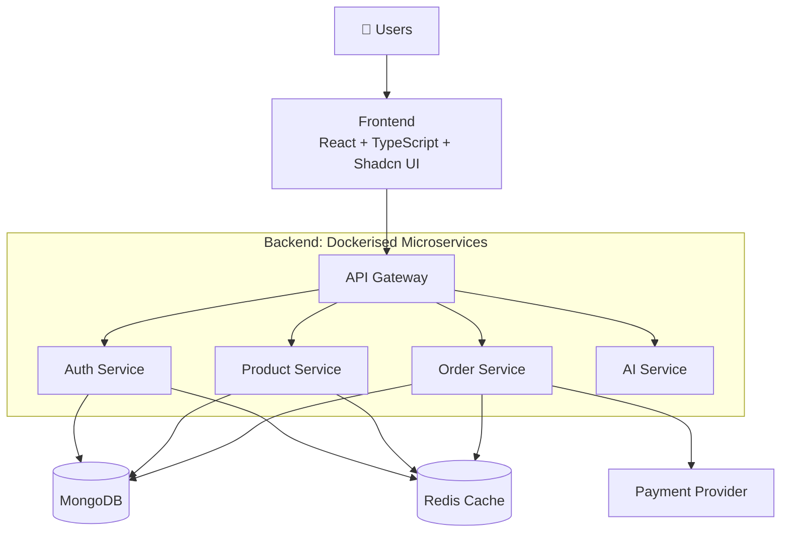

<h1 align="center">🛒 SELLORAAI</h1>

<p align="center">
  <b>A scalable digital product marketplace built on a microservices architecture.</b><br/>
  Buyers discover, purchase and download digital products. Sellers manage listings and sales.
</p>

<p align="center">
  
  
  
  
  
  
  
</p>

<p align="center">
  <a href="#-live-demo">Live Demo</a> •
  <a href="#-architecture">Architecture</a> •
  <a href="#-what-this-project-demonstrates">Skills Shown</a> •
  <a href="#-run-it-in-2-minutes">Quick Start</a> •
  <a href="#-about-the-author">Author</a>
</p>

---

## 🔗 Live Demo

| | |
|---|---|
| 🌐 **Live app** | `https://your-demo-link-here` |
| 🎥 **Video walkthrough (2 min)** | `https://your-video-link-here` |
| 🔑 **Demo login** | `demo@sellora.ai` / `demo1234` *(replace with real test credentials)* |

> 📸 **Add 2–3 screenshots or a GIF here.** Recruiters spend about 30 seconds on a repo, and visuals are the fastest way to prove it works.
>
> `` `` ``

---

## ✨ The Pitch

Most portfolio projects are single-server CRUD apps. **SELLORAAI is built the way production systems are:** independent services behind an API gateway, Redis caching for performance, everything containerised with Docker, and cloud-ready for AWS.

**In one line:** a full-stack marketplace where a user can sign up, browse products, pay, and download what they bought, with each backend concern running as its own service.

---

## 🎯 What This Project Demonstrates

| Skill | Where to see it |
|---|---|
| **Microservices design** | Separate `auth`, `product`, `order` and `ai` services in `backend/services/` |
| **API Gateway pattern** | Single entry point routing all client traffic in `backend/gateway/` |
| **Authentication & authorization** | JWT-based auth service protecting routes |
| **Caching strategy** | Shared Redis utility in `backend/shared/redis/` used across services |
| **Payment & order workflow** | Order service handling purchase flow and digital download access |
| **TypeScript end to end** | Typed React frontend and Node/Express backend |
| **Modern UI engineering** | React + Shadcn UI component system |
| **DevOps basics** | Docker and Docker Compose for one-command startup, AWS deployment ready |

---

## 🚀 Features

| | Feature | Details |
|---|---|---|
| 🔐 | **Authentication** | Secure sign-up, login and role-based access |
| 🛍️ | **Marketplace** | Browse and explore digital products |
| 📦 | **Product management** | Sellers create and manage listings |
| 💳 | **Payments** | Purchase flow with payment integration |
| 🧾 | **Orders** | Order creation and purchase history |
| 📥 | **Digital downloads** | Access purchased files after payment |
| ⚡ | **Redis caching** | Faster responses on frequently read data |
| 🤖 | **AI service** | Dedicated, isolated service for AI features |

---

## 🏛️ Architecture



### Services

| Service | Responsibility |
|---|---|
| **Gateway** | Single entry point; routes and forwards API requests |
| **Auth** | Registration, login, tokens, authorization |
| **Product** | Product listings and seller catalogue |
| **Order** | Purchases, order state, download access |
| **AI** | Isolated service for AI-related features |
| **Shared / Redis** | Reusable Redis connection utility shared by services |

### 🧩 Design Decisions

- **Why microservices?** Each domain (auth, products, orders, AI) can be developed, deployed and scaled independently.
- **Why an API Gateway?** The frontend talks to one endpoint, which keeps cross-cutting concerns in one place and hides internal service layout.
- **Why Redis?** Reduces repeated database reads on hot paths and speeds up responses.
- **Why Docker Compose?** The whole system starts with one command, so anyone can run it locally.

---

## 🧰 Tech Stack

| Layer | Technologies |
|---|---|
| **Frontend** | React.js, TypeScript, Shadcn UI |
| **Backend** | Node.js, Express.js, TypeScript |
| **Database** | MongoDB |
| **Cache** | Redis |
| **Architecture** | Microservices, API Gateway, REST APIs |
| **DevOps** | Docker, Docker Compose |
| **Cloud** | AWS |

---

## 📂 Project Structure

```bash
SELLORAAI/
├── backend/
│   ├── gateway/              # API Gateway (single entry point)
│   ├── services/
│   │   ├── auth/             # Authentication & authorization
│   │   ├── product/          # Product catalogue
│   │   ├── order/            # Orders, payments, downloads
│   │   └── ai/               # AI-related features
│   ├── shared/
│   │   └── redis/redis.js    # Shared Redis connection
│   ├── docker-compose.yml
│   └── package.json
├── frontend/                 # React + TypeScript client
└── README.md
```

---

## ⚡ Run It in 2 Minutes

**Prerequisites:** Docker and Docker Compose (Node.js 18+ if running without Docker).

```bash
# 1. Clone
git clone <YOUR_REPOSITORY_URL>
cd SELLORAAI

# 2. Add environment variables (see below)

# 3. Start the whole backend
cd backend
docker compose up --build

# 4. Start the frontend (new terminal)
cd frontend
npm install
npm run dev
```

<details>
<summary><b>🔧 Environment variables</b></summary>

Create `.env` files for the frontend and each backend service:

```env
PORT=
MONGODB_URI=
JWT_SECRET=
REDIS_URL=
PAYMENT_SECRET=
AWS_ACCESS_KEY_ID=
AWS_SECRET_ACCESS_KEY=
```

Variables may differ per service. Never commit secrets to the repository.
</details>

<details>
<summary><b>🧑‍💻 Run without Docker</b></summary>

```bash
cd backend
npm install
npm run dev        # start each service via its dev script
```

Requires local MongoDB and Redis instances.
</details>

---

## 🗺️ Roadmap

- [x] Microservices architecture with API Gateway
- [x] Authentication and authorization
- [x] Product and order management
- [x] Redis caching layer
- [x] Dockerised setup
- [ ] Automated tests and CI pipeline (GitHub Actions)
- [ ] API documentation (Swagger / OpenAPI)
- [ ] Rate limiting and centralised logging
- [ ] AI-powered product recommendations and search
- [ ] Full AWS deployment (ECS / EC2) with IaC

---

## 📚 What I Learned

- Splitting a monolith into services with clear boundaries and a gateway in front.
- Where caching helps, and how to share a Redis layer across services.
- Securing a multi-service system with centralised authentication.
- Packaging and running multi-container apps with Docker Compose.

---

## 👨‍💻 About the Author

**Your Name**: Full-Stack Developer (React, Node.js, TypeScript)

I build scalable web applications and enjoy designing backend systems that are modular and maintainable.

📧 your.email@example.com  
💼 [LinkedIn](https://linkedin.com/in/your-profile)  
🌐 [Portfolio](https://your-portfolio.com)  
🐙 [GitHub](https://github.com/your-username)

> 🟢 **Open to full-stack / backend roles.** Feel free to reach out!

---

<p align="center">
  ⭐ If you found this project interesting, please consider starring the repo!
</p>